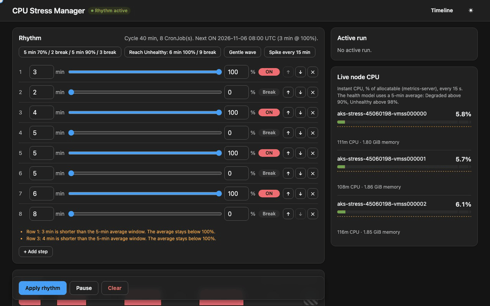
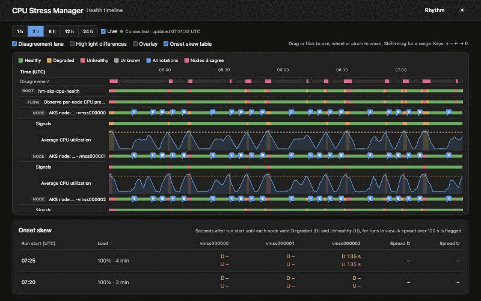
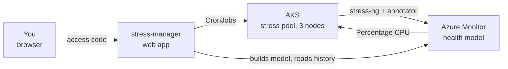
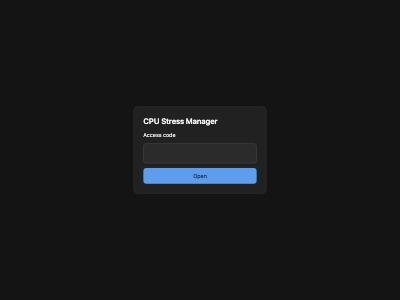
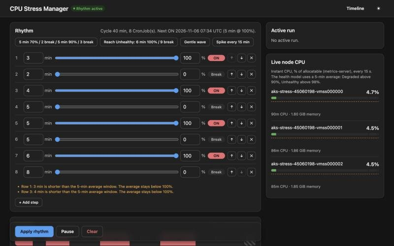
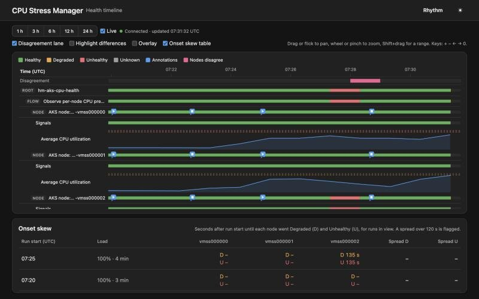
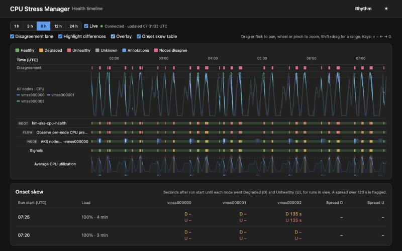

# CPU health demo

Stress three AKS nodes on a repeating schedule and watch an Azure Monitor health model turn them Degraded and Unhealthy, with a start and end marker for every run.



## What you get

- **AKS cluster** with a fixed pool of three stress nodes.
- **Stress manager**, a .NET web app. You design a stress rhythm (for example 5 min at 100%, 2 min break, repeated forever) and it runs as Kubernetes CronJobs.
- **Health model** with one entity per node and the signal "average CPU, 5 minutes", Degraded above 90%, Unhealthy above 98%.
- **Data annotations** written by each stress run when it starts and ends, so the health history shows what caused each state change.
- **Health timeline**, a page that draws every node's state, CPU and annotations on one time axis, so you can see whether the nodes degrade together.



## How it fits together



1. The manager compiles your rhythm into CronJobs. Each ON step becomes one or more cron lines in UTC.
2. When a CronJob fires, it starts a Job with one pod per stress node. The pod runs `stress-ng` at the step's load.
3. A sidecar in the same pod writes a `start` annotation on its node's health model entity once stress-ng runs, and an `end` annotation when the pod stops.
4. The health model evaluates each node's CPU every minute. The timeline page reads that history and the annotations.

Details: [docs/aks/spec.md](docs/aks/spec.md) (contract) and [docs/aks/timeline.md](docs/aks/timeline.md) (timeline API).

## Deploy

You need the [Azure Developer CLI](https://aka.ms/azd), the Azure CLI, [kubelogin](https://azure.github.io/kubelogin/) and the .NET 10 SDK. Docker is not needed; the image builds in Azure Container Registry.

1. Sign in and create an environment:

   ```bash
   azd auth login
   ```

   ```bash
   azd env new aks-cpu-health --location swedencentral
   ```

2. Pick an access code for the website. It stays in your local azd environment and is deployed as a Kubernetes Secret:

   ```bash
   azd env set STRESS_ACCESS_CODE <your-code>
   ```

3. Deploy everything:

   ```bash
   azd up
   ```

   `azd up` prints the site address at the end (`Load Balancer: http://<ip>`).

4. Optional, to use `kubectl` (the cluster accepts Microsoft Entra ID sign-in only):

   ```bash
   az aks get-credentials -g rg-aks-cpu-health -n aks-aks-cpu-health
   ```

   ```bash
   kubelogin convert-kubeconfig -l azurecli
   ```

Costs: three `Standard_D2s_v5` stress nodes, one `Standard_B2s_v2` system node, extra nodes that Node Auto Provisioning adds, a load balancer and a public IP. Remove everything with `azd down`.

## Use it

### Sign in

Open the site and enter your access code. The browser keeps you signed in for 30 days.



### Design a rhythm



- Each row is a step: minutes and load. Load 0 is a break.
- Presets fill the editor. "Reach Unhealthy" (6 min at 100%, 9 min break) is the quickest way to see the model react.
- The preview shows one cycle, how often it repeats per day, the next start time and the CronJobs it will create.
- The cycle must divide 24 hours. If yours doesn't, the last break grows and the preview says by how much.
- Rows under 5 minutes or at 90% load or below get a warning: the health signal averages 5 minutes, so those steps never reach Degraded.
- **Apply rhythm** writes the CronJobs. **Pause** suspends them and stops the running step. **Clear** deletes them.
- The right column shows the running step and live CPU per node from metrics-server (instant values; the health model uses the 5-minute average).

### Read the timeline

Click **Timeline** in the header.

| | |
|---|---|
|  |  |
| Zoomed in to one run: start and end markers, the CPU curve and the state bands | Overlay and highlight: all node CPU lines in one chart, agreement dimmed |

- Each node has an entity state band, a signal band and a CPU chart with dashed lines at 90% and 98%.
- Blue markers are annotations; close markers merge into a numbered bubble.
- **Disagreement lane**: pink where the nodes are in different states.
- **Highlight differences**: dims the time where all nodes agree.
- **Overlay**: one chart with every node's CPU.
- **Onset skew table**: for each run, how many seconds after the start each node went Degraded and Unhealthy, and the spread between nodes. A spread over 120 s is flagged.
- Wheel or pinch to zoom, drag or flick to pan, Shift+drag to zoom into a range. Keys: `+` `-` `←` `→` `0`. **Back to live** returns to the newest data.
- The page caches history in the browser and receives only new points.

## Proof from the health model API

`scripts/aks-proof.sh` prints each node's state changes and annotations from the health model API:

```bash
scripts/aks-proof.sh 2026-11-05T21:10:00Z
```

Recorded runs: [docs/aks/proof.md](docs/aks/proof.md) and [docs/aks/proof-rhythm.md](docs/aks/proof-rhythm.md).

## Develop

```bash
dotnet test src/StressManager.sln
```

Pure logic (rhythm compiler and reducer, Job template, layout, timeline analysis) lives in `src/StressManager/Calculations` and is covered by parametrized xUnit tests. Kubernetes and Azure calls live in `Actions` and `Services`.

## VM demo

The repo also holds the earlier version on three virtual machines: `infra/main.bicep`, `infra/healthmodel.bicep`, `scripts/deploy.sh` (read-only checks unless `--deploy` is given), `scripts/verify.sh` and the Python tests in `tests/`. It does not use azd. Its health model is documented in [docs/healthmodel/modelspec.md](docs/healthmodel/modelspec.md).
