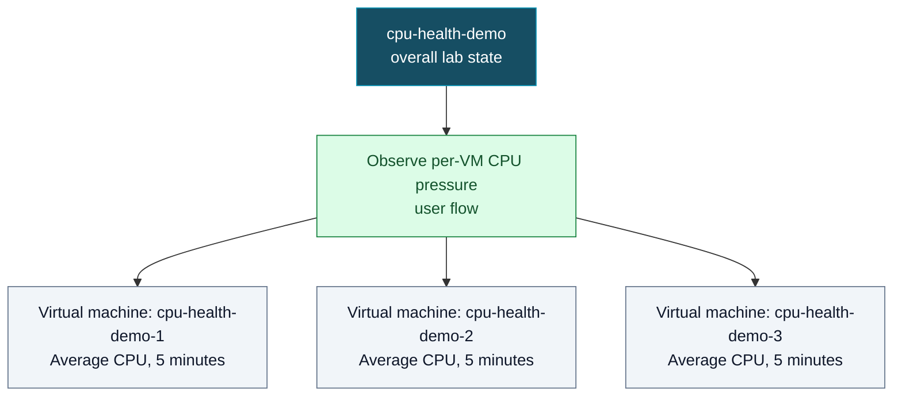

# Health model modelspec: CPU health demo

## What does health mean for this workload?

- Health means each demo VM's average CPU utilization is within the agreed range.
- This is a deliberately stressed lab. A high CPU state is expected during burst tests.
- Website availability is outside the demo's scope.

## Health modelling strategy

| Model Name | Purpose and platform/workload role | Owner and team/organizational/legal boundary | Tenant, subscription and resource scope | Sources or gap | Status |
|---|---|---|---|---|---|
| `M_CPU_DEMO` / `cpu-health-demo` | Show CPU pressure for the three demo VMs | Local demo project; organizational owner unknown | Tenant `<AZURE_TENANT_ID>`; subscription `<AZURE_SUBSCRIPTION_ID>`; `rg-cpu-health-demo`, Sweden Central | S1, S2, S8, S11, S14 | Deployed and evaluating |

## High-level health model diagram

## User concerns and priorities

| Concern or priority | User impact and service expectations | Sources or gap | Status |
|---|---|---|---|
| Detect deliberate CPU pressure | Show each VM crossing the user's 90% degraded and 98% unhealthy thresholds, then recovering | S1, S3 | new |

## User flows

| Flow | User outcome and steps | Health objective | Dependencies and resources | Sources or gap | Status |
|---|---|---|---|---|---|
| `F_CPU_DEMO` | Observe CPU health for each demo VM during and after stress bursts | Not specified; objective left unset pending decision, G1 | Three VM resources, each with its own CPU signal | S1, S3 | new |

## System flows

| Flow | System interactions | Health objective | Dependencies and resources | Sources or gap | Status |
|---|---|---|---|---|---|
| No separate virtual system component | CPU is measured directly on each VM. A pass-through virtual layer would add no distinct health meaning. | Not applicable | `F_CPU_DEMO` depends directly on `E_VM1`, `E_VM2`, `E_VM3` | S1, S3 | new |

## Alerts

| Alert | Confirmed placement and health objective | Existing rule and suitability | Sources, lookup coverage or gap | Status |
|---|---|---|---|---|
| None planned | No alert was requested; no action group is selected | Existing alert rules not inventoried; G2 | S1, G2 | new |

## Shared source material

### S1: Workload request

- Evidence class: user-stated intent
- Original location/reference: conversation, 2026-11-05 10:03 +01:00, input I1
- Precise locator and version: request for three VMs and CPU stress; website later removed from scope
- Status: new

### S2: Azure target selection

- Evidence class: user decision
- Original location/reference: conversation, input I2 and I5
- Precise locator and version: subscription display name and selected local project
- Status: new

### S3: CPU threshold decision

- Evidence class: user decision
- Original location/reference: conversation, input I6
- Precise locator and version: Average over five minutes, refresh each minute, Degraded above 90%, Unhealthy above 98%
- Status: new

### S4: Azure Monitor health-model concepts

- Evidence class: research
- Original location/reference: https://learn.microsoft.com/en-us/azure/azure-monitor/health-models/concepts
- Precise locator and version: health states, entities, signals and propagation
- Status: new

### S5: Well-Architected health modeling

- Evidence class: research
- Original location/reference: https://learn.microsoft.com/en-us/azure/well-architected/design-guides/health-modeling
- Precise locator and version: workload context and measurable signal thresholds
- Status: new

### S6: VM supported metrics

- Evidence class: research
- Original location/reference: https://learn.microsoft.com/en-us/azure/azure-monitor/reference/supported-metrics/microsoft-compute-virtualmachines-metrics
- Precise locator and version: `Percentage CPU`, Average, Percent and supported time grain
- Status: new

### S7: Azure scope and provider lookup

- Evidence class: observed read-only Azure lookup
- Original location/reference: Azure MCP health-model list and `az provider show`, subscription `<AZURE_SUBSCRIPTION_ID>`
- Precise locator and version: `Microsoft.CloudHealth` is registered and lists Sweden Central; no model or resource group for this demo existed at lookup time
- Status: new

### S8: Health-model plan approval

- Evidence class: user decision
- Original location/reference: conversation history, 2026-11-05; exact message and time unavailable
- Precise locator and version: user approved the drafted CPU-focused plan; approval covers the plan, not Azure deployment
- Status: accepted

### S9: Read-only deployment preflight

- Evidence class: observed Azure CLI preflight and what-if
- Original location/reference: `bash scripts/deploy.sh`, subscription `<AZURE_SUBSCRIPTION_ID>`, 2026-11-05
- Precise locator and version: Sweden Central SKU eligible; regional vCPU 8/100 and DSv5 0/100, with 6 required; three subscription policies listed for review; what-if showed 12 resource creates
- Status: new; no Azure resources changed; allocation and policy compatibility not proven

### S10: Public retail cost estimate

- Evidence class: Azure Retail Prices API lookup and Microsoft IP pricing page
- Original location/reference: `https://prices.azure.com/api/retail/prices`, `api-version=2023-01-01-preview`; `https://azure.microsoft.com/en-us/pricing/details/ip-addresses/`, 2026-11-05
- Precise locator and version: Standard_D2s_v5 Linux $0.102/hour; S4 LRS disk $1.536/month; Standard static IPv4 $0.005/hour; estimate assumes 730 hours and three of each
- Status: new; estimated $238.94 USD/month before bandwidth, disk operations, tax or subscription discounts

### S11: VM deployment and scope update

- Evidence class: deployment and user decision
- Original location/reference: subscription deployment `cpu-health-demo-20261105143844`; conversation, 2026-11-05
- Precise locator and version: three VMs deployed in `rg-cpu-health-demo`; user chose to keep them and remove the HTTP workload
- Status: accepted

### S12: Live CPU metric verification

- Evidence class: read-only Azure metric queries
- Original location/reference: `az monitor metrics list-definitions` and `az monitor metrics list`, 2026-11-05
- Precise locator and version: each VM supports `Percentage CPU` in Percent with Average at PT1M and PT5M; all three returned non-null data
- Status: verified

### S13: Stress bootstrap and HTTP removal

- Evidence class: user approvals, VM Run Command and Azure network configuration
- Original location/reference: `infra/cloud-init.yaml`, `cpu-health-stress.service`, `nsg-cpu-health-demo`; conversation, 2026-11-05
- Precise locator and version: cloud-init failed because `/bin/sh` rejected `pipefail`; the corrected bootstrap was approved and started the stress service on all three VMs; the `AllowHttp` rule was removed after approval
- Status: services enabled and active; stress transitions still being verified

### S14: Health-model deployment and evaluation

- Evidence class: user approval and Azure deployment/readback
- Original location/reference: `bash scripts/deploy.sh --health-model --deploy`, resource group `rg-cpu-health-demo`; deployment `cpu-health-model-20261105173436`, 2026-11-05 17:35 UTC
- Precise locator and version: model, four explicit entities, four relationships, three VM-scoped Reader assignments and the shared CPU definition deployed; at 17:36 UTC the three signals reported 99.55% Unhealthy, 98.72% Unhealthy and 21.22% Healthy
- Status: deployed and evaluating; unhealthy states are expected under stress

### S15: Live stress transitions

- Evidence class: read-only health-model signal observations
- Original location/reference: `bash scripts/verify.sh --live` and entity readback, 2026-11-05 17:36–17:41 UTC
- Precise locator and version: VM 1 reported 99.55% Unhealthy then 78.22% Healthy; VM 2 reported 98.72% Unhealthy then 65.40% Healthy; VM 3 reported 99.54% Unhealthy then 79.01% Healthy
- Status: all three stress and recovery transitions observed; the 81-minute run was stopped when synchronized stress was requested

### S16: Synchronized stress rollout

- Evidence class: user approval and Azure VM Run Command
- Original location/reference: `stress/run.sh`, `cpu-health-stress.service`; conversation, 2026-11-05
- Precise locator and version: user approved a common 18:27 UTC schedule epoch and a one-second target based on VM system clocks; the 20:21 UTC burst had 0.345 ms start and 4.295 ms stop skew, and the 20:28 UTC burst had 0.246 ms start and 7.501 ms stop skew
- Status: deployed; both observed synchronized bursts met the one-second target

### S17: CPU telemetry after synchronization

- Evidence class: Azure metric and health-model readback
- Original location/reference: `az monitor metrics list` and health-model entities, 2026-11-05 20:22–20:26 UTC
- Precise locator and version: one-minute CPU samples around the first burst reached 52.07%, 72.38% and 87.67%; at 20:26 UTC the model reported 33.49%, 25.67% and 25.76% Healthy for the respective five-minute averages
- Status: all three synchronized VMs are supplying CPU data

## User input and decisions

| Input or decision and affected items | Attribution and source | Input/decision date/time | Recorded at | Status |
|---|---|---|---|---|
| Three VMs, CPU-focused health, `F_CPU_DEMO`, `E_VM1`-`E_VM3` | User, S1 | 2026-11-05 10:03 +01:00 | 2026-11-05 +01:00 | new |
| Subscription and project scope, `M_CPU_DEMO` | User, S2 | 2026-11-05; exact time unavailable | 2026-11-05 +01:00 | new |
| CPU thresholds and evaluation window, `SIG_CPU1`-`SIG_CPU3` | User, S3 | 2026-11-05; exact time unavailable | 2026-11-05 +01:00 | new |
| Health-model plan approved; no Azure deployment approved at that time | User, S8 | 2026-11-05; exact time unavailable | 2026-11-05 12:20 +01:00 | accepted |
| Deploy the model with a system-assigned identity and VM-scoped Reader roles | User @abossard, S14 | 2026-11-05 before 17:34:36 UTC; exact time unavailable | 2026-11-05 17:35 UTC | accepted |
| Keep the deployed VMs and remove HTTP from the demo | User, S11 | 2026-11-05 | 2026-11-05 +01:00 | accepted |
| Repair and start the CPU stress service on all three VMs; remove the `AllowHttp` rule | User, S13 | 2026-11-05 | 2026-11-05 +01:00 | accepted |
| Align stress burst starts and stops within one second using VM system clocks | User @abossard, S16 | 2026-11-05 20:11 UTC | 2026-11-05 20:16 UTC | accepted; deployed |

## Derived entity plan

| Model and entity identity/role | Flows, resources and dependencies | Proposed health meaning and user impact | Supporting sources and short derivation | Evidence gaps or conflicts | Intent acceptance | Status |
|---|---|---|---|---|---|---|
| `M_CPU_DEMO`, implicit root | Root of the three-VM CPU demo | Worst-of its children; Unknown until signals return | S1, S3, S4, S14 | G1 | Accepted; deployed | done |
| `F_CPU_DEMO`, user flow | Depends on `E_VM1`, `E_VM2`, `E_VM3` | Summarizes CPU pressure across all three instances | S1, S3, S4, S14 | G1 | Accepted; deployed | done |
| `E_VM1`, VM resource | `cpu-health-demo-1`, `F_CPU_DEMO` | Healthy at <=90%; Degraded >90% through 98%; Unhealthy >98% | S1, S3, S6, S14 | G3 | Accepted; evaluating | done |
| `E_VM2`, VM resource | `cpu-health-demo-2`, `F_CPU_DEMO` | Healthy at <=90%; Degraded >90% through 98%; Unhealthy >98% | S1, S3, S6, S14 | G3 | Accepted; evaluating | done |
| `E_VM3`, VM resource | `cpu-health-demo-3`, `F_CPU_DEMO` | Healthy at <=90%; Degraded >90% through 98%; Unhealthy >98% | S1, S3, S6, S14 | G3 | Accepted; evaluating | done |

## Signals

| Signal | Entity | Kind and data source | Measurement | Degraded and unhealthy rule | Sources or gap | Verification | Status |
|---|---|---|---|---|---|---|---|
| `SIG_CPU1` | `E_VM1` | Azure resource metric on VM 1 | `Percentage CPU`, Average, PT5M window, PT1M refresh | >90%; >98% | S3, S6, S12–S14, S17 | 33.49% Healthy at 20:26 UTC; no error | done |
| `SIG_CPU2` | `E_VM2` | Azure resource metric on VM 2 | `Percentage CPU`, Average, PT5M window, PT1M refresh | >90%; >98% | S3, S6, S12–S14, S17 | 25.67% Healthy at 20:26 UTC; no error | done |
| `SIG_CPU3` | `E_VM3` | Azure resource metric on VM 3 | `Percentage CPU`, Average, PT5M window, PT1M refresh | >90%; >98% | S3, S6, S12–S14, S17 | 25.76% Healthy at 20:26 UTC; no error | done |

## Gaps and open decisions

| Gap or conflict | Category | Affected items | Known evidence and alternatives | Required resolution and owner | Status |
|---|---|---|---|---|---|
| G1: Health objective not specified | user input | `M_CPU_DEMO`, `F_CPU_DEMO` | CPU thresholds are known; no uptime objective was given | User may accept no objective for this lab or specify one | new |
| G2: Alert routing and existing rules not selected | user input / research/lookup | `M_CPU_DEMO`, `F_CPU_DEMO` | No action group was requested; no alert inventory was checked | Keep alerts out of scope unless user names routing; if requested, inspect only agreed scope | new |
| G3: Synchronized stress verification | research/lookup | `E_VM1`-`E_VM3`, `SIG_CPU1`-`SIG_CPU3` | All three VMs previously reported high CPU and Healthy recovery; two synchronized bursts met the one-second start and stop target | A full 57-minute synchronized cycle has not yet been observed | partially verified |
| G4: Model identity role assignments | research/lookup | `E_VM1`-`E_VM3`, `M_CPU_DEMO` | The deployed identity has Reader on each VM; all signals report values | None | resolved |
| G5: Deployment cost estimate | research/lookup | `M_CPU_DEMO` | VM allocation succeeded; S10 is public retail pricing and excludes variable costs and subscription discounts | Review account-specific charges | open |
| G6: Subscription policy assignments need effect review | research/lookup | VM deployment | Three subscription assignments were listed; the preflight does not evaluate their effect on the planned resources | Review the assignments and deployment what-if before approving; Azure may still reject a deployment | open |

## Intent acceptance

| Concrete intent and affected models/entities | State | Attributable user acceptance/reference | Status |
|---|---|---|---|
| CPU-focused lab model with three VM CPU signals and the selected thresholds | Deployed; signals evaluating | S1-S3, S8, S14 | accepted |
