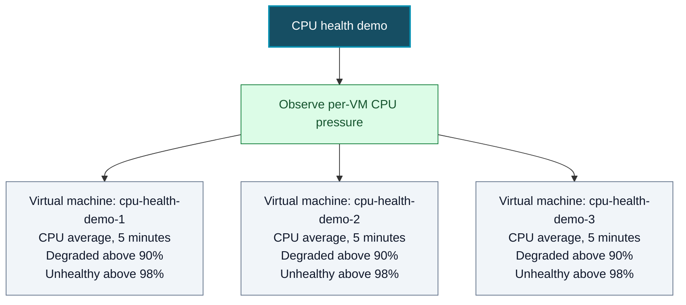

# Health Model for CPU health demo

## What does health mean for my workload?

- Each demo machine's CPU usage is measured separately.
- Above 90% is degraded. Above 98% is unhealthy.
- These machines are deliberately stressed, so those states are expected during the test.
- Website availability is outside the demo's scope.

## User flows

| User flow | What users do | Depends on | Signals | Health target | Alert |
|---|---|---|---|---|---|
| Observe per-VM CPU pressure | Run the demo and see which machine is under load | Three demo virtual machines | Average CPU over the last five minutes on each machine | Not set | None planned |

## Diagram

**Colors:** dark teal = model, green = user flow, gray = Azure virtual machines.

The model has one machine for each CPU signal. It rolls up the worst machine state to the demo. When a five-minute average rises above 90%, that machine becomes degraded. Above 98%, it becomes unhealthy. It can recover after the average returns to 90% or lower. Missing readings remain unknown.

## What happens when something breaks

| If this happens | The model shows | Alert |
|---|---|---|
| One machine's five-minute CPU average rises above 90% | That machine and the demo flow become degraded | None planned |
| One machine's average rises above 98% | That machine and the demo flow become unhealthy | None planned |
| CPU readings are missing | The affected machine is unknown; the demo may also be unknown | None planned |

## Assumptions

- The model will be deployed in Sweden Central with the demo resources.
- The model has no health objective or notification routing until those are chosen.
- The model is about CPU pressure, not website availability.

## What to do next?

The model is deployed and all three CPU signals are reporting. Verify each VM's
stress-driven health transition and subsequent recovery.
